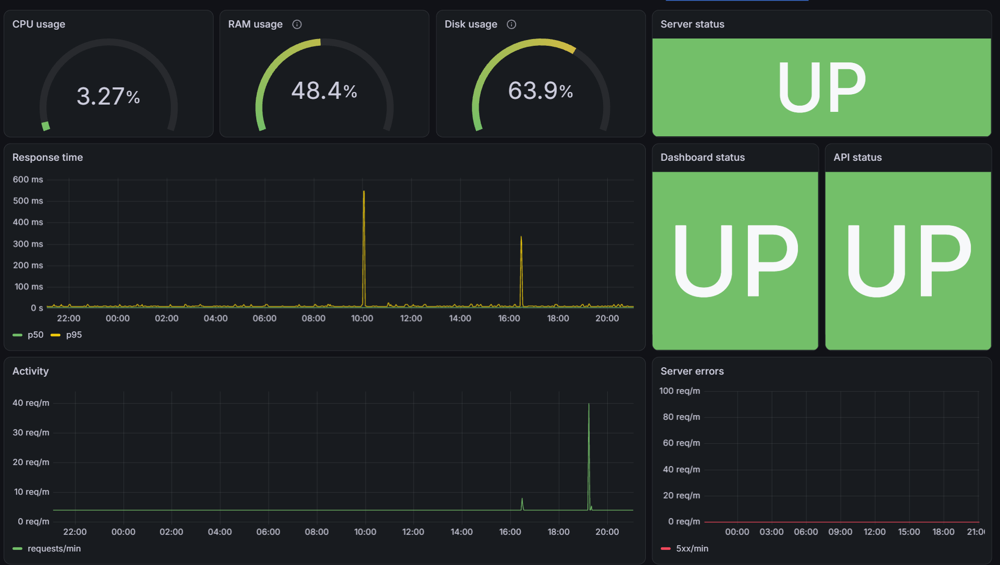
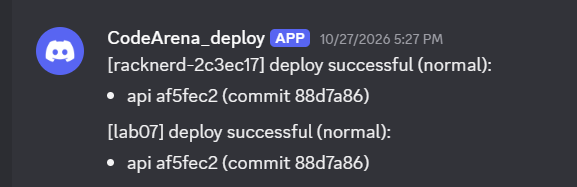
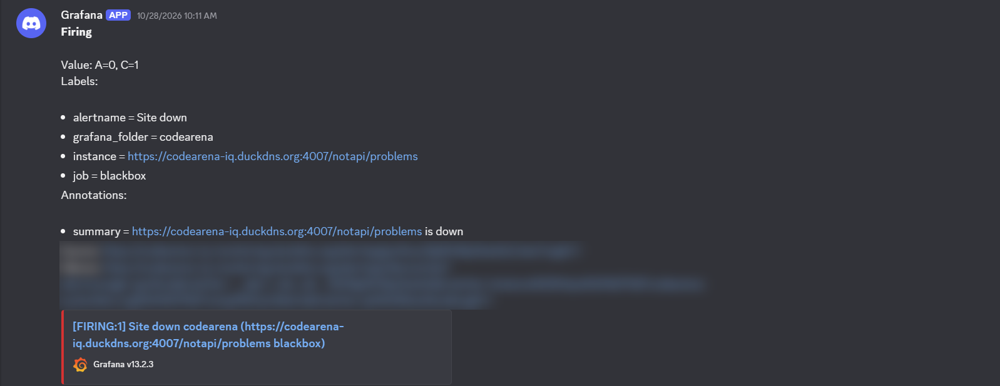
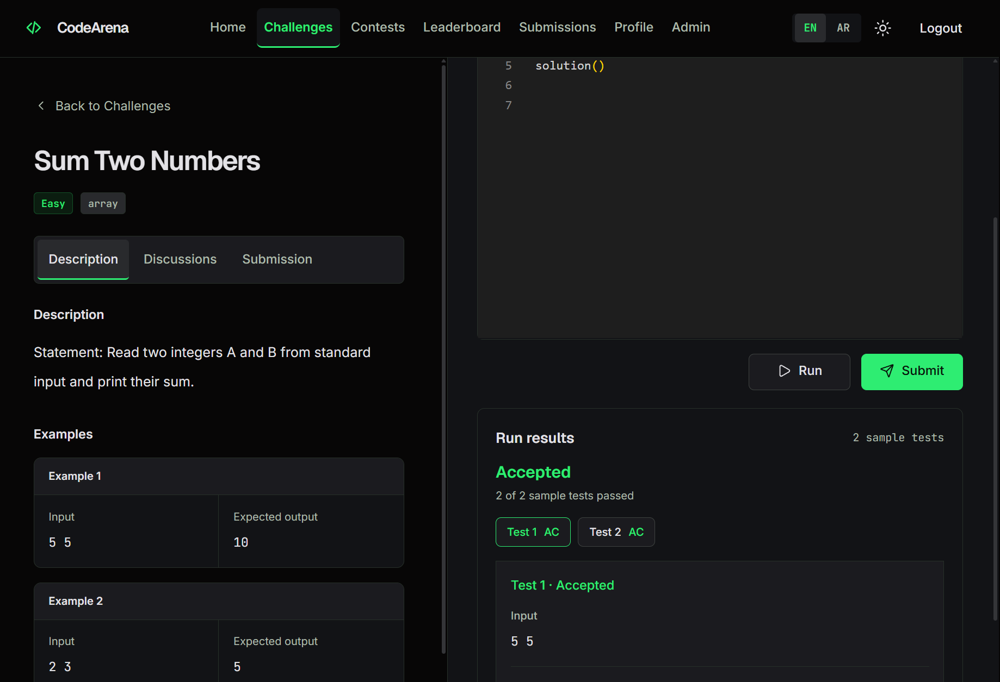
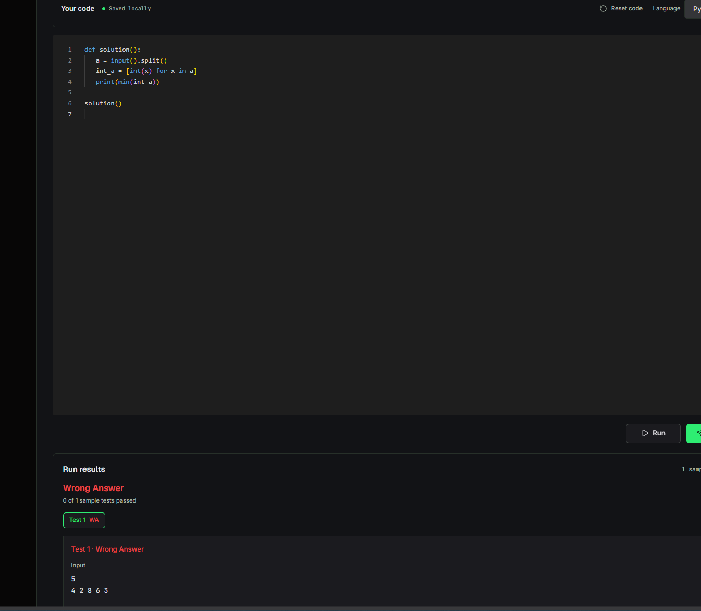
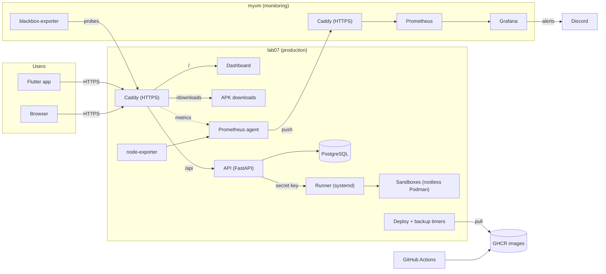

# CodeArena Infrastructure

Infrastructure I built and ran for **CodeArena**, a LeetCode-style platform where users solve programming problems in the browser or a companion app and their code is judged in isolated sandboxes.

CodeArena was a 4-person team project in the Techies Lab DevOps program (Oct 2026). My teammates built the frontend, backend and Flutter app. I built and operated all of the infrastructure, which is this repo.

> **Status: archived.** The platform ran in production during and after the course, then was shut down in Nov 2026 when its server was decommissioned. This is my copy of the infrastructure repo, kept as a record of the work. CI is disabled here.

## What it covered
- **Server setup:** an Ansible playbook that builds a server from a fresh AlmaLinux 10 install
- **Deployment:** a pull-based deploy script, systemd timers and a Docker Compose stack
- **Code runner:** the service that runs untrusted user code in rootless Podman sandboxes
- **Monitoring:** Prometheus, a Grafana dashboard and Discord alerts, on a separate server
- **Backups:** daily database backups with a tested restore

## Results
- **Reproducible servers:** rebuilt a server from a fresh AlmaLinux 10 reinstall with the playbook alone (no manual steps beyond bootstrap), and every runner verdict passed on the rebuilt server.
- **Zero-downtime migration:** moved the production runner from Docker to rootless Podman, and removed the runner user from the `docker` group, without taking the site down.
- **Security review:** an informal penetration test by the course instructor found no way in.
- **Monitoring that ran in production:** a week of real traffic, with alerts reaching Discord (see below).

## Screenshots
| | |
|---|---|
|  | Grafana: 24 hours of production traffic (Nov 2026) |
|  | Pull-based deploy: both servers deploy the same pinned image from the same commit |
|  | Testing the alert path: the blackbox probe was pointed at a bad URL to confirm "Site down" reaches Discord |
|  | The runner judging a correct solution |
|  | The runner catching wrong output |

## Architecture

## Decisions
The course scope called for Podman and Nginx. I used Docker and Caddy instead, with the instructor's approval.

- **Docker for the stack, rootless Podman for sandboxes:** the stack runs our own images, built in CI, so Docker is fine there. User code is untrusted, so it runs in rootless Podman as an unprivileged `runner` user with no sudo and no Docker access. Even if code escaped its sandbox, it would land as a user that can't do anything. Giving the runner Docker would have made it root-equivalent.
- **Caddy as the single entry point:** one door for everything (`/api`, `/downloads`, the dashboard), with the API's own port closed. Caddy gets and renews certificates automatically, and its DuckDNS plugin does it over DNS, which mattered because the shared lab gateway gave us no port 80. It also rate-limits the API per IP.
- **One Compose file:** the whole production stack is in one file, so it starts with one command, is reviewed in one place, and the deploy script only has to watch one file.
- **Pull-based deploy:** lab07 sat behind a shared gateway, so CI couldn't reach it anyway. Instead the server pulls changes every minute, holding only read-only credentials. A compromised CI can't push anything to the server.
- **Push-based monitoring on a separate server:** the gateway didn't expose lab07's ports, so lab07 pushes its metrics out. Monitoring lives on its own server so it keeps working, and keeps alerting, when production is down.
- **gVisor evaluated and declined:** under rootless Podman it didn't enforce limits (a 1 GB allocation succeeded inside a 256 MB limit), and running it as root would undo the rootless design. Details in [security.md](docs/security.md).

## Known limitations
The state at shutdown, including what I'd fix next.

- **CPU contention:** `RUNNER_MAX_CONCURRENT` (2) × CPU per sandbox (0.5) used a whole core on lab07's single vCPU, so bursts of submissions slowed the site. The option was concurrency 1 on lab07.
- **Throughput not measured:** runner jobs per minute were never benchmarked.
- **Output was fully buffered before truncation.** `subprocess.run(capture_output=True)` reads all output into the runner before `MAX_OUTPUT` (64 KB) is applied, outside the sandbox limits. On lab07 a print loop pushed the runner from 43 MB to 668 MB, and about 230 MB stayed allocated until restart.
  - **Mitigation:** `MemoryMax=400M`, `MemorySwapMax=0` and concurrency 1. A flood OOM-kills the runner, which restarts in 5 s; affected users see "runner unavailable" and queued runs are lost. This was applied by hand and never added to Ansible.
  - **Fix:** stream output with `subprocess.Popen` and kill the container once it passes `MAX_OUTPUT`.
- **The secret check failed open.** If `RUNNER_SECRET_KEY` was unset, the check was skipped. Fix: refuse to start without it.
- **Incident: Podman 6 sent rootless users to root's storage.** An unattended `dnf-automatic` run (Nov 17, 2026) upgraded Podman to 6.1.1 (ALSA-2026:98554). Podman 6 applies `graphroot`/`runroot` from the packaged `/usr/share/containers/storage.conf` to rootless users too, so every run failed with `internal_error` (exit 125, `mkdir /var/lib/containers/storage/libpod: permission denied`) while the service showed active and the API returned 200.
  - **Fix:** explicit paths in `/home/runner/.config/containers/storage.conf` (owned by `runner`): `graphroot = "/home/runner/.local/share/containers/storage"`, `runroot = "/run/user/994/containers"`. Applied by hand and never added to Ansible.
  - **Mitigation:** `dnf-automatic.timer` was disabled for the testing freeze (Nov 18 to Dec 4). The planned follow-up was to re-enable it and versionlock the Podman stack. Security-only updates would not have helped, because the rebase shipped as a security advisory.
  - **Lesson:** a 200 response doesn't prove that runs work. A smoke test that checks for `"status":"ok"` would have caught this.

## Docs
| Doc | Answers |
|---|---|
| [server_setup.md](docs/server_setup.md) | How do I build a server for CodeArena? |
| [deploy.md](docs/deploy.md) | How does code reach production? |
| [runner.md](docs/runner.md) | How is untrusted code run safely, and with which limits? |
| [security.md](docs/security.md) | What's protected, and what's still a risk? |
| [monitoring.md](docs/monitoring.md) | How do we know it's healthy, and what do we do when an alert fires? |
| [optimization.md](docs/optimization.md) | How does it fit on a small server, and how much load can it take? |
| [backup.md](docs/backup.md) | How do we back up and restore data? |

## Repo layout
| Path | What |
|---|---|
| `compose.yml` | The production stack |
| `Caddyfile` | Routing, HTTPS, rate limit |
| `caddy/` | Custom Caddy image (DuckDNS + rate-limit plugins) |
| `ansible/` | Playbook, inventory, vault, templates |
| `deploy/` | `deploy.py`: the pull-based deploy |
| `runner/` | The code runner (languages in `languages.py`) |
| `backup/` | `backup.py`: daily DB backups |
| `systemd/` | Deploy and backup units and timers |
| `monitoring/` | Monitoring stack, Grafana provisioning, agent config |
| `tests/` | Runner tests |
| `.github/workflows/` | CI and the Caddy image build (disabled in this copy) |

## Where secrets live
All secrets come from one place, the Ansible vault (`ansible/group_vars/all/vault.yml`). Each service gets only its own.

| Vault variable | Written to | Used by |
|---|---|---|
| `vault_infra_env` | `/opt/code_arena/infra/.env` | API, DB |
| `vault_caddy_env` | `infra/caddy/caddy.env` | App Caddy (DuckDNS token) |
| `vault_deploy_env` | `/etc/code_arena/deploy.env` | Deploy, backups |
| `vault_runner_env` | `/etc/code_arena/runner.env` | Runner |
| `vault_push_password` | `infra/monitoring/agent/push_password` | Metrics push (lab07) |
| `vault_monitoring_caddy_env` | `infra/monitoring/caddy.env` | Monitoring Caddy (token, push user + hash) |
| `vault_grafana_env` | `infra/monitoring/grafana.env` | Grafana admin, URL, Discord webhook |
| `vault_deploy_infra_key`, `vault_ghcr_user`, `vault_ghcr_token` | `~student/.ssh/deploy/`, Docker login | Every server |

## About these docs
The docs were written with AI assistance from my notes. Every decision, test and result in them is mine, and I reviewed everything they say.