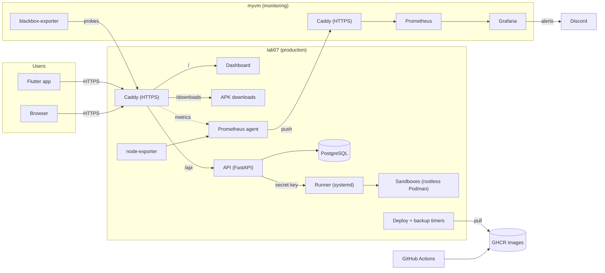

# CodeArena DevOps (Team 7)

Infrastructure for **CodeArena**, a LeetCode-style platform: users solve programming problems in the browser or the companion app, and their code is judged in isolated sandboxes.

This repo holds everything that runs the platform:
- **Server setup:** Ansible playbook that builds the servers from a fresh install
- **Deployment:** pull-based deploy script, systemd timers, Docker Compose stack
- **Code runner:** the service that runs user code in sandboxes
- **Monitoring:** Prometheus, Grafana dashboard and Discord alerts
- **Backups:** daily database backups with a tested restore

| | URL |
|---|---|
| Platform | https://codearena-iq.duckdns.org:4007 |
| API docs (Swagger) | https://codearena-iq.duckdns.org:4007/api/docs |
| APK download | https://codearena-iq.duckdns.org:4007/downloads/codearena.apk |
| Monitoring | https://codearena-iq-monitoring.duckdns.org |

## Architecture

## Decisions
Docker and Caddy are used instead of the scope's Podman and Nginx, approved by the trainer.

- **Docker for the stack, rootless Podman for sandboxes:** the stack runs our own images, built in CI, so Docker is fine there. User code is untrusted, so it runs in rootless Podman as an unprivileged `runner` user with no sudo and no Docker access. Even if code escaped its sandbox, it would land as a user that can't do anything. Giving the runner Docker would have made it root-equivalent.
- **Caddy as the single entry point:** one door for everything (`/api`, `/downloads`, the dashboard), with the API's own port closed. Caddy gets and renews certificates automatically, and its DuckDNS plugin does it over DNS, which matters because the shared lab gateway gives us no port 80. It also rate-limits the API per IP.
- **One Compose file:** the whole production stack is in one file, so it starts with one command, is reviewed in one place, and the deploy script only has to watch one file.
- **Pull-based deploy:** lab07 sits behind a shared gateway, so CI can't reach it anyway. Instead the server pulls changes every minute, holding only read-only credentials. A compromised CI can't push anything to the server.
- **Push-based monitoring on a separate server:** the gateway doesn't expose lab07's ports, so lab07 pushes its metrics out. Monitoring lives on its own server so it keeps working, and keeps alerting, when production is down.
- **gVisor evaluated and declined:** under rootless Podman it didn't enforce limits (a 1 GB allocation succeeded inside a 256 MB limit), and running it as root would undo the rootless design. Details in [security.md](docs/security.md).

## Docs
| Doc | Answers |
|---|---|
| [server_setup.md](docs/server_setup.md) | How do I build a server for CodeArena? |
| [deploy.md](docs/deploy.md) | How does code reach production? |
| [runner.md](docs/runner.md) | How is untrusted code run safely, and with which limits? |
| [security.md](docs/security.md) | What's protected, and what's still a risk? |
| [monitoring.md](docs/monitoring.md) | How do we know it's healthy, and what do we do when an alert fires? |
| [optimization.md](docs/optimization.md) | How does it fit on a small server, and how much load can it take? |
| [backup.md](docs/backup.md) | How do we back up and restore data? |

**Deployment runbook** (scope deliverable): `server_setup.md` + `deploy.md`.

## Repo layout
| Path | What |
|---|---|
| `compose.yml` | The production stack |
| `Caddyfile` | Routing, HTTPS, rate limit |
| `caddy/` | Custom Caddy image (DuckDNS + rate-limit plugins) |
| `ansible/` | Playbook, inventory, vault, templates |
| `deploy/` | `deploy.py`: the pull-based deploy |
| `runner/` | The code runner (languages in `languages.py`) |
| `backup/` | `backup.py`: daily DB backups |
| `systemd/` | Deploy and backup units and timers |
| `monitoring/` | Monitoring stack, Grafana provisioning, agent config |
| `tests/` | Runner tests |
| `.github/workflows/` | CI and the Caddy image build |

## Where secrets live
All secrets come from one place, the Ansible vault (`ansible/group_vars/all/vault.yml`). Each service gets only its own.

| Vault variable | Written to | Used by |
|---|---|---|
| `vault_infra_env` | `/opt/code_arena/infra/.env` | API, DB |
| `vault_caddy_env` | `infra/caddy/caddy.env` | App Caddy (DuckDNS token) |
| `vault_deploy_env` | `/etc/code_arena/deploy.env` | Deploy, backups |
| `vault_runner_env` | `/etc/code_arena/runner.env` | Runner |
| `vault_push_password` | `infra/monitoring/agent/push_password` | Metrics push (lab07) |
| `vault_monitoring_caddy_env` | `infra/monitoring/caddy.env` | Monitoring Caddy (token, push user + hash) |
| `vault_grafana_env` | `infra/monitoring/grafana.env` | Grafana admin, URL, Discord webhook |
| `vault_deploy_infra_key`, `vault_ghcr_user`, `vault_ghcr_token` | `~student/.ssh/deploy/`, Docker login | Every server |

## About these docs
The docs were written with AI assistance from my notes. Every decision, test and result in them is mine, and I reviewed everything they say.